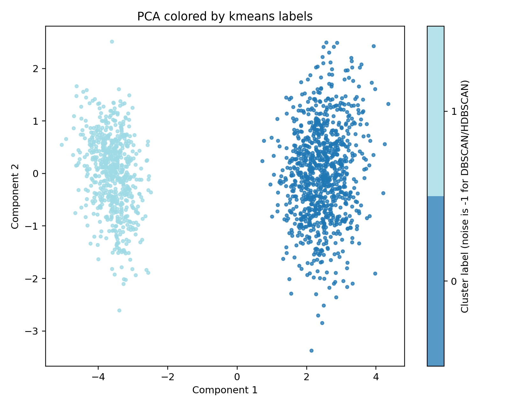
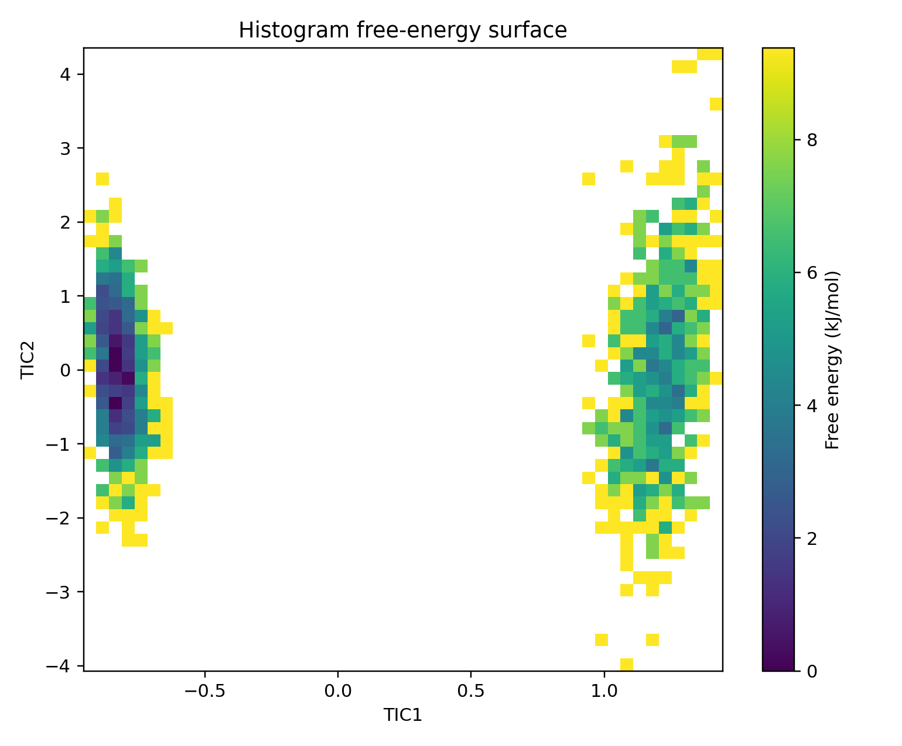

# MD State-Space Analysis

**Reproducible feature-space analysis for molecular-dynamics trajectories: periodic-feature handling, clustering, PCA, tICA, basic state-transition diagnostics, and optional autoencoders.**

> Development status: **alpha (`0.1.0a2`)**. The package provides reusable analysis primitives; it does not certify a selected feature set, cluster count, tICA lag, or MSM as scientifically valid. Production analyses require trajectory-level validation and explicit physical-unit metadata.

## Why this package exists

The associated research code explores protein–protein encounter ensembles using inter-protein distances, vector-orientation angles, salt-bridge/contact features, density clustering, PCA projections, tICA, free-energy projections, and MSM tutorials. Those scripts were written for specific file layouts and often mix analysis, plotting, and I/O in one script. This package extracts common, testable methods and replaces working-directory assumptions with explicit inputs and options.

## Capabilities

- **Feature tables:** validate CSV/TSV input and retain trajectory, segment, and frame metadata.
- **Periodic features:** encode angular variables using sine/cosine so wraparound values remain neighbors.
- **Clustering:** K-means, DBSCAN, optional HDBSCAN; cluster sizes, noise fraction, silhouette and Davies–Bouldin scores where defined, and adjusted Rand index for comparing partitions.
- **PCA:** projection scores, explained variance tables, and plots.
- **tICA:** covariance-based tICA with explicit lag in saved frames, trajectory-boundary protection, eigenvalues, and implied timescale diagnostics.
- **Lag diagnostics:** compare tICA eigenvalues/timescales and calculate a VAMP-2 score over specified frame lags.
- **Transitions:** basic state-transition matrix and implied-timescale diagnostics from supplied discrete labels. These helpers are intentionally modest and not a replacement for a validated MSM package.
- **Optional autoencoder:** a small PyTorch baseline for latent-space exploration. This is a newly implemented baseline; the uploaded source archives did not contain a matching autoencoder training script.

## Install

Python 3.10 or later is required.

```bash
python -m pip install -e '.[test]'
```

Optional density clustering and neural latent-space dependencies:

```bash
python -m pip install -e '.[density]'  # HDBSCAN
python -m pip install -e '.[latent]'   # PyTorch autoencoder
python -m pip install -e '.[all]'      # all optional dependencies plus pytest
```

## Quick start

Run the complete synthetic demonstration. It creates a multi-trajectory example, runs PCA/tICA/K-means, and writes plots and tables to the output directory.

```bash
mdstate demo --outdir demo_run
```

Or from the source checkout:

```bash
python -m pip install -e '.[test]'
mdstate demo --outdir demo_run
pytest -q
```

For a real feature table, specify feature columns explicitly. Metadata such as `Trajectory`, `Segment`, and `Frame` is not used as a model feature. The column names below are examples; replace them with names present in your table.

```bash
mdstate analyze features.tsv \
  --outdir analysis_run \
  --features d_A1X1_nm,d_A1Y1_nm,d_A2X2_nm,d_B2Y2_nm,angle_AX,angle_BX,angle_AY,angle_BY \
  --angle-degrees angle_AX,angle_BX,angle_AY,angle_BY \
  --trajectory-column Trajectory \
  --segment-column Segment \
  --frame-column Frame \
  --lag-time 10 \
  --algorithm kmeans \
  --n-clusters 5
```

The `--lag-time` value is **in saved frames**, not ps or ns. Convert a desired physical lag to frames using the true output interval from the simulation, and keep that interval in the analysis notes. If your table does not include a `Segment` column, omit `--segment-column`; if a simulation was split into multiple files, use a segment identifier so time-lag pairs cannot bridge file boundaries.


### Clustering parameter sensitivity

Do not infer an optimal cluster count from a single run. The sweep helper compares K-means over multiple `k` values and random seeds, including the pairwise adjusted Rand index between seed-specific partitions. It also supports a DBSCAN grid and reports cluster count/noise fraction.

```bash
mdstate cluster-sweep features.tsv --features d_A1X1,d_A1Y1,d_A2X2,d_B2Y2,angle_AX,angle_BX,angle_AY,angle_BY \
  --angle-degrees angle_AX,angle_BX,angle_AY,angle_BY \
  --mode kmeans --k-values 2,3,4,5,6,7,8 --seeds 42,43,44 \
  --out cluster_sweep.tsv
```

For the archived 12-dimensional yeast MBD–chaperone feature table, the JSON specification can be used directly after verifying the headers:

```bash
mdstate analyze vector_distance-angles_output.tsv \
  --feature-spec configs/yeast_mbd_chaperone_12d.json \
  --outdir analysis_run --lag-time 10 --algorithm kmeans --n-clusters 5
```

The archived generator reports distance outputs in Å and angles in degrees; verify the table headers before using this configuration. Explicit CLI values override the specification.

### tICA lag-time analysis

```bash
mdstate tica-lags features.tsv \
  --out tica_lags.tsv \
  --features d_A1X1_nm,d_A1Y1_nm,d_A2X2_nm,d_B2Y2_nm,angle_AX,angle_BX,angle_AY,angle_BY \
  --angle-degrees angle_AX,angle_BX,angle_AY,angle_BY \
  --trajectory-column Trajectory --segment-column Segment --frame-column Frame \
  --lags 1,2,5,10,20,50 --components 3
```

## Example results (synthetic data only)

The demo generates two persistent synthetic states to illustrate outputs. These figures are software examples, not results from the copper-trafficking simulations.

**PCA projection colored by K-means labels**



**Histogram FES from the synthetic tICA projection**



## Outputs from `mdstate analyze`

- `feature_map.tsv`, `feature_transform.json`: encoded feature names and scaling parameters.
- `pca_scores.tsv`, `pca_explained_variance.tsv`, `pca_projection.png`, `pca_explained_variance.png`.
- `tica_scores.tsv`, `tica_eigenvalues.tsv`, `tica_metadata.json`.
- `clustered_features.tsv`, `cluster_sizes.tsv`, `cluster_metrics.json`, `pca_colored_by_cluster.png`.
- `analysis_summary.json`: compact record of the requested analysis choices.

Outputs are written beneath the selected output directory. Existing output files with the same names will be overwritten, so use a fresh directory for each run.


### Histogram free-energy surface from a projection

For **unbiased equilibrium samples**, make a 2D histogram FES from a saved projection (such as `TIC1`, `TIC2`). For biased sampling, only use this command after supplying valid reweighting weights; it does not calculate metadynamics weights itself.

```bash
mdstate fes mdstate_results/tica_scores.tsv \
  --coordinates TIC1,TIC2 \
  --temperature 310 \
  --bins 60 \
  --outdir fes_results
```

This writes `fes.tsv`, `fes_2d.png`, and `fes_metadata.json`. Free energy is calculated as `-kBT ln(probability mass)` and shifted so the minimum occupied bin is zero; empty bins remain infinite.

## Python API examples

```python
import pandas as pd
from mdstate.preprocessing import encode_features
from mdstate.dimensionality import fit_pca, fit_tica
from mdstate.clustering import fit_kmeans, cluster_summary, score_clustering
from mdstate.io import split_feature_trajectories

df = pd.read_csv("features.tsv", sep="\t")
features = ["d_A1X1_nm", "d_A1Y1_nm", "angle_AX", "angle_BX"]
X, transform = encode_features(df, features, angle_degrees=["angle_AX", "angle_BX"])
pca, scores = fit_pca(X, n_components=2)
trajectories = split_feature_trajectories(X, df, "Trajectory", "Segment", "Frame")
tica = fit_tica(trajectories, lag_time=10, n_components=2)
model, labels = fit_kmeans(X, n_clusters=5, random_state=42)
print(cluster_summary(labels))
print(score_clustering(X, labels))
```

## Autoencoder baseline (optional PyTorch)

The autoencoder expects already encoded and scaled features. To avoid validation leakage from temporally correlated frames, split at the **trajectory level** and pass held-out trajectory data as `X_validation`.

```python
from mdstate.autoencoder import fit_autoencoder

# X_train and X_validation must use the same fitted feature transform.
result = fit_autoencoder(X_train, X_validation=X_validation, latent_dim=2, seed=42)
latent_train = result.encode(X_train)
latent_validation = result.encode(X_validation)
result.save("autoencoder_checkpoint.pt")
```

Reconstruction quality alone does not demonstrate a kinetically meaningful collective variable. For dynamical interpretation, validate latent spaces using held-out trajectories, lagged prediction/variational scores, robustness to seeds and architecture, and downstream kinetic diagnostics.

## Methodological guardrails

1. **Never create lagged pairs across independent trajectories or file segments.** Pass correct trajectory and segment IDs.
2. **Feature selection is scientific input.** Avoid inadvertently including cluster labels, frame IDs, Cu–S labels, or downstream outcomes as features.
3. **Scale and weight features deliberately.** StandardScaler puts scalar columns on unit variance but does not resolve choices between distances, angles, and binary observables.
4. **Encode periodic angles.** An unencoded angle can make values near -180° and +180° appear far apart.
5. **PCA is variance-focused, not kinetic.** A visually clear PCA plot is not evidence that the slow modes are resolved.
6. **tICA is lag-dependent.** Inspect implied timescales, eigenvalues, feature/lag sensitivity, and sampling before interpreting a slow mode.
7. **Density clustering noise is not a physical state.** Scores in this package exclude label -1 for silhouette/DB scores, and the noise fraction is reported separately.
8. **MSM claims require additional validation.** The included transition helpers are diagnostic primitives; perform implied-timescale convergence and Chapman–Kolmogorov tests using a validated MSM workflow before reporting kinetics.
9. **Autoencoder validation should be trajectory-wise.** Randomly splitting neighboring MD frames can produce an overly optimistic validation loss.
10. **Reproducibility requires time metadata.** Record saved-frame stride, units, feature definitions, software versions, random seeds, and any filtering.

More detail: [`docs/methodological-notes.md`](docs/methodological-notes.md) and [`docs/legacy-script-map.md`](docs/legacy-script-map.md).

## Scientific scope and limitations

This package does not read raw MD trajectories to calculate all protein features; it starts from a feature table. Trajectory featurization should be handled by the separate copper-protein analysis toolkit or a controlled upstream workflow. The code does not assume a specific biology, optimal number of clusters, optimal lag, or a converged MSM. Synthetic tests are software checks, not validation of a production analysis.

## License and citation

License selection and authorship details are intentionally unresolved. See [`LICENSE-STATUS.md`](LICENSE-STATUS.md). Replace the placeholder author/contact in `pyproject.toml` and `CITATION.cff` before publication.

## Associate clusters with mechanistic outcomes

Join cluster assignments to an independent, per-frame mechanism table by explicit identity columns. Never join by row order. For the existing research-style cluster-label table, while joining the standardized identity fields produced by the copper analysis toolkit:

```bash
mdstate associate results/clustered_features.tsv mechanism_features.tsv \
  --label-keys Trajectory,Segment,Frame \
  --mechanism-keys trajectory_id,segment_id,local_frame \
  --trajectory-column Trajectory \
  --cluster-column cluster_label \
  --threshold 'CuS_distance_A<=3.5' \
  --threshold 'salt_bridge_count>=1' \
  --outdir results/cluster_mechanism
```

If both input tables use identical key names, use `--join-keys KEY1,KEY2,KEY3` instead.

Both files must have exactly one row per identity key and exactly the same frame-key set. If a mechanism file contains long-form rows (for example, one row per salt bridge per frame), aggregate it to one row per frame before joining. Outputs include a joined frame table, cluster-level descriptive summaries, and per-trajectory/per-cluster summaries. Use the per-trajectory table for replicate-aware comparisons; frames are temporally correlated and must not be treated as independent replicates. A distance threshold such as 3.5 Å is a user-defined close-contact event, not a proof of bond formation or reactivity.
